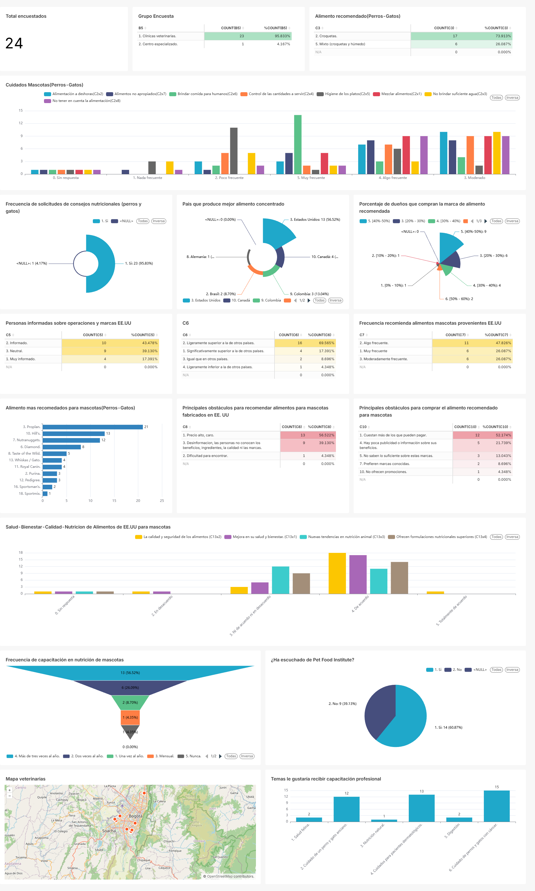

# 🐾 Análisis de Encuestas Veterinarias | Apache Superset

## 📊 Descripción del proyecto

Desarrollo de un dashboard interactivo en Apache Superset para analizar los resultados de encuestas realizadas a clínicas veterinarias sobre alimentación, nutrición y recomendación de alimentos para perros y gatos.

El proyecto permite explorar las preferencias de los profesionales veterinarios, las marcas de alimentos más recomendadas, los factores que influyen en la compra de productos y las necesidades de capacitación en nutrición animal.

## 🎯 Objetivos

- Analizar las respuestas recopiladas en las encuestas veterinarias.
- Identificar los alimentos y las marcas más recomendadas para mascotas.
- Examinar los principales factores que influyen en la recomendación y compra.
- Explorar la percepción sobre la calidad y los beneficios nutricionales de los alimentos.
- Identificar obstáculos comerciales, como el precio y el desconocimiento de las marcas.
- Visualizar las necesidades de capacitación profesional en nutrición animal.

## 📈 Indicadores y análisis

El dashboard incluye:

- Total de encuestados y distribución de las respuestas.
- Alimentos recomendados para perros y gatos.
- Hábitos y cuidados relacionados con la alimentación.
- Frecuencia de recomendación de alimentos importados.
- Marcas más recomendadas por los participantes.
- Percepción de calidad, seguridad y tendencias nutricionales.
- Principales obstáculos para recomendar y comprar alimentos.
- Frecuencia y temas de interés para la capacitación profesional.
- Distribución geográfica de las clínicas veterinarias encuestadas.

## 🛠️ Herramientas utilizadas

- **Apache Superset:** desarrollo del dashboard y visualización de datos.
- **Encuestas:** fuente de información para el análisis.
- **Visualización de datos:** gráficos de barras, gráficos circulares, tablas e indicadores.
- **Análisis exploratorio:** identificación de patrones y comparación de respuestas.

## 💡 Valor del proyecto

Este dashboard transforma los resultados de encuestas en visualizaciones que facilitan la interpretación de las preferencias y tendencias del sector veterinario.

La solución permite consultar diferentes indicadores en un solo lugar, comparar respuestas e identificar oportunidades de análisis relacionadas con la alimentación de mascotas y la formación de los profesionales veterinarios.

## 👨‍💻 Competencias demostradas

- Análisis e interpretación de datos.
- Diseño de dashboards interactivos.
- Visualización de información.
- Análisis de encuestas.
- Comunicación de información para apoyar la toma de decisiones.

  ## 🖼️ Vista previa del dashboard

---

*Proyecto de portafolio de análisis de datos. Los resultados corresponden a la muestra de encuestados y no necesariamente representan a todo el sector veterinario.*
